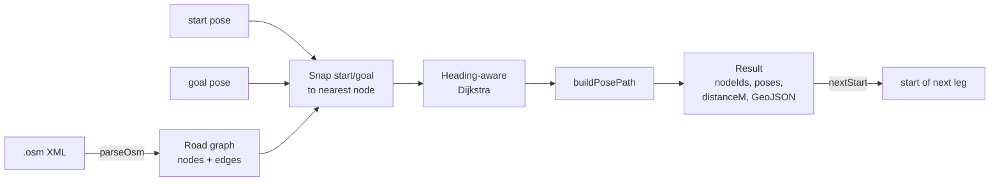

# How osm-route-planner works

This page explains what happens inside the package, from reading the `.osm` file to returning a route with poses.



## 1. Reading the OSM file (`parseOsm`)

The package does not download or upload anything on its own. It works on the OSM XML text you give it:

| You have | Call |
|---|---|
| XML string | `planRouteFromOsm(xmlText, opts)` or `parseOsm(xmlText)` |
| file on disk (Node) | `planRouteFromFile('map.osm', opts)` (uses `fs`) |
| URL | `await planRouteFromUrl(url, opts)` (uses `fetch`) |

`parseOsm` uses `@xmldom/xmldom` to read the XML and builds a road graph:

- **Nodes.** Every `<node id lat lon>` is stored as `id → { lat, lon }`.
- **Edges.** Every `<way>` is a list of `<nd ref>` nodes, and each pair of neighbouring nodes becomes an edge. Each edge stores:
  - `dist`: the haversine distance in metres
  - `bearing`: the compass direction of travel (0 = North, clockwise)
- **One-way roads.** The way's `oneway` tag decides which edges exist:

  | `oneway` tag | Edges created |
  |---|---|
  | missing / `no` | a→b and b→a |
  | `yes`, `1`, `true` | a→b only |
  | `-1`, `reverse` | b→a only |

The result is `{ nodes, adj, ways }`. Parse a map once with `parseOsm`, then call `planRoute(graph, …)` as many times as you like. On big maps this is much faster than re-parsing for every route.

## 2. Input: start and goal poses

```js
{
  start: { position: { lat, lon }, orientation: { x, y, z, w } },
  goal:  { position: { lat, lon }, orientation: { x, y, z, w } },
}
```

`orientation` is a quaternion in the **ROS ENU** convention, the same one boson_webapp's `/computepath` API uses:

- Yaw is taken from `z` and `w`. `x` and `y` are optional and default to 0.
- ENU yaw: 0° = East, counter-clockwise, so 90° = North.
- Internally it becomes a compass heading: `compass = (90 − yaw + 360) % 360`.
- If you have a compass heading (for example from GPS), convert it with `quatFromBearing(deg)`.

| Facing | compass | ENU yaw | `{ z, w }` |
|---|---|---|---|
| North | 0° | 90° | `{ 0.7071, 0.7071 }` |
| East | 90° | 0° | `{ 0, 1 }` |
| South | 180° | 270° | `{ -0.7071, 0.7071 }` |
| West | 270° | 180° | `{ 1, 0 }` |

Both orientations are required. If either is missing, the call throws `BAD_INPUT`.

## 3. Snapping to the road (`nearestNode`)

The start and goal positions usually don't sit exactly on a road node. Each one is snapped to the **closest node in the graph**, using haversine distance over all nodes.

- If both snap to the same node, the call throws `SAME_NODE`.
- If the graph has no nodes, the call throws `NO_NODES`.

> On very large maps (about 70k nodes) this linear search takes about 1 s per route. On normal maps it takes a few milliseconds.

## 4. Finding the path: heading-aware Dijkstra

A normal shortest-path search ignores which way the vehicle faces, so it can return a route that starts with a U-turn. This search tracks heading as part of the state.

- **State** = `(node, heading bucket)`. Headings are rounded to 10° buckets, so the same node can be visited facing different directions.
- **Cost** = distance driven in metres.
- **Start state** = the start node with the start heading.
- **Expanding a state.** From each state, the search follows every outgoing edge whose bearing is **within 90°** of the current heading. Edges that need a turn sharper than 90° are skipped, so the route never makes a U-turn or a sharp turn back.
- **Next state** = `(edge.to, edge.bearing)`. The vehicle now faces the direction of the edge it just drove.
- **Goal check.** The search stops at the goal node only if the arrival heading is **within 90°** of the goal heading.
- **No path.** If nothing satisfies those rules, the call throws `NO_PATH`.

Example (the square map in `example/map.osm`: 1-2-3-4, plus a one-way diagonal 1→3):

```
  2 ───── 3
  │     ↗ │      start at 1 facing NE (45°)  → 1 → 3        (diagonal, 77.6 m)
  │   ↗   │      start at 1 facing SE (160°) → 1 → 4 → 3    (diagonal needs >90° turn)
  1 ───── 4
```

## 5. Building poses (`buildPosePath`)

Each node on the path becomes a pose:

| Pose | Orientation |
|---|---|
| first | the start orientation you passed in |
| middle | direction from this point to the next point |
| last | the goal orientation you passed in |

If a segment has zero length (two nodes in the same place), it keeps the previous heading instead of jumping to 0°.

Each pose looks like `{ position: { lat, lon }, orientation: { x, y, z, w }, yaw_deg }`. `yaw_deg` is ENU.

## 6. Output

```js
{
  nodeIds:   ['123', '124', ...],     // OSM node ids along the route
  poses:     [{ position, orientation, yaw_deg }, ...],
  distanceM: 95.42,                   // total length in metres
  feature:   { type: 'Feature', geometry: { type: 'LineString', coordinates: [[lon, lat], ...] },
               properties: { distance_m: 95.42 } },
}
```

`feature` is standard GeoJSON. Coordinates are `[lon, lat]`, so it can go straight onto a Leaflet or Mapbox map, or into a mission file.

## 7. Multi-route (chained legs)

This works like the boson_webapp Route Planner: after a route is planned, the next route continues from where it ended.

```
 leg 1: start ──────────► goal1
                            │  nextStart(leg1)
                            ▼
 leg 2:                   start2 ──────────► goal2
```

`nextStart(route)` returns:

- **position**: the last point of the route
- **orientation**: the direction of the route's **last segment** (second-last point → last point), so the vehicle keeps facing the way it actually arrived. Zero-length segments at the end are skipped.

Two ways to use it:

**One leg at a time** (a UI where the user picks each goal after seeing the route):

```js
const graph = parseOsm(osmText);
let start = vehiclePose;
const leg1 = planRoute(graph, { start, goal: goal1 });
start = nextStart(leg1);
const leg2 = planRoute(graph, { start, goal: goal2 });
// undo leg2 → start = nextStart(leg1) again
```

**All legs at once:**

```js
const trip = planMultiRoute(graph, { start: vehiclePose, goals: [goal1, goal2, goal3] });
trip.legs;       // one planRoute result per leg
trip.poses;      // all poses joined; each joint point appears once
trip.distanceM;  // total
trip.feature;    // one LineString for the whole trip
```

If a leg fails, the thrown `RoutePlanError` has `err.leg` (0-based) and a message like `leg 2: No path matches ...`.

## 8. Errors

All errors are `RoutePlanError` with a `code`:

| code | Meaning | Typical fix |
|---|---|---|
| `BAD_INPUT` | missing position or orientation, or an empty `goals` | check the request body |
| `NO_NODES` | the OSM file has no usable nodes | wrong or empty file |
| `SAME_NODE` | start and goal snap to the same node | pick a goal further away |
| `NO_PATH` | no route respects one-way roads and the 90° heading rules | flip the start or goal heading, or check the road's one-way direction |

## 9. Limits

- Roads come only from `<way>` elements. Tags like `highway` aren't filtered, so every way in the file counts as drivable.
- There's no U-turn: a start facing the wrong way on a dead end gives `NO_PATH`.
- Snapping picks the nearest **node**, not the nearest point on a road segment.
- The output matches boson_webapp's `computePath` exactly (verified on 200 random routes over 5 real maps). It's the same code without the GCS fetch.
